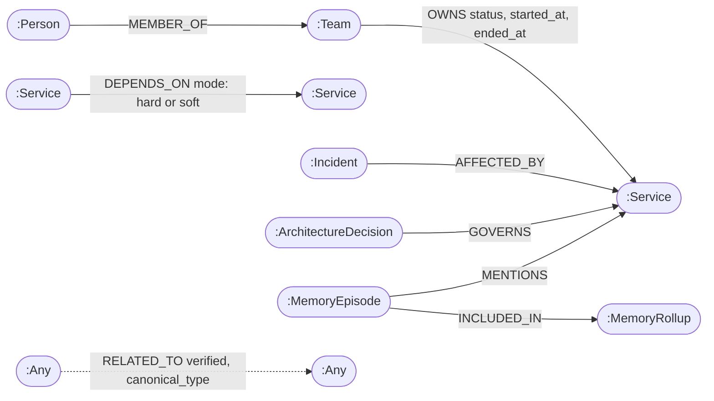

# HashiraGraph

> **Self-Healing Multi-Agent Memory, Dependency Intelligence, and Company Brain on FalkorDB**

[](https://falkordb.com/)
[](https://streamlit.io/)
[](https://www.python.org/)
[]()

**Submission for Graph Hacks 2026**  
**Team Name:** hashira  
**Team Code:** N6F3C3  
**Repository:** [https://github.com/Sohamdhumal7/HashiraGraphDb](https://github.com/Sohamdhumal7/HashiraGraphDb)  

---

## Table of Contents

- [A. Project Title and Introduction](#a-project-title-and-introduction)
- [B. Key Features](#b-key-features)
- [C. Architecture](#c-architecture)
- [D. Graph Data Model](#d-graph-data-model)
- [E. FalkorDB and Cypher Queries](#e-falkordb-and-cypher-queries)
- [F. Technology Stack](#f-technology-stack)
- [G. Prerequisites](#g-prerequisites)
- [H. Complete Local Installation Instructions](#h-complete-local-installation-instructions)
- [I. Environment Variables and Security](#i-environment-variables-and-security)
- [J. Usage Guide](#j-usage-guide)
- [K. Hackathon Tracks](#k-hackathon-tracks)
- [L. AI Assistance Disclosure](#l-ai-assistance-disclosure)
- [M. Limitations and Roadmap](#m-limitations-and-roadmap)
- [N. Contributing and License](#n-contributing-and-license)

---

## A. Project Title and Introduction

### Project Name
**HashiraGraph**

### Purpose
HashiraGraph is a graph-native organizational intelligence engine and persistent agent memory platform built on **FalkorDB**. It provides transparent, verifiable knowledge retrieval, multi-hop cascading failure simulation, graph-derived fragility analysis, and self-healing memory maintenance for modern engineering organizations.

### The Problem It Solves
Modern distributed software systems suffer from organizational and architectural opacity:
- **Scattered Tribal Knowledge:** Service ownership, architectural decisions (ADRs), incident histories, and team assignments are fragmented across Slack channels, wiki pages, and issue trackers.
- **Hidden Outage Blast Radii:** When a critical tier-0 service degrades or crashes, on-call engineers cannot easily see transitive multi-hop dependencies (which apps stop working completely vs. which ones degrade gracefully).
- **Stateless AI Hallucination:** Standard AI chat agents suffer from stateless context loss across sessions and frequently hallucinate imaginary service names, nonexistent API routes, and unverified owners.

### Who It Is Designed For
- **Site Reliability Engineers (SREs) & On-Call Responders:** To simulate outage propagation before maintenance windows and generate incident remediation playbooks.
- **Platform & Systems Architects:** To inspect single points of failure, evaluate system betweenness centrality, and track Architecture Decision Records.
- **Engineering Leadership & Product Teams:** To identify team ownership boundaries, inspect incident impact histories, and retain institutional memory across conversations.

### Why Graph-Based Knowledge Retrieval Is Essential
Relational databases require expensive recursive SQL joins to compute transitive dependencies, while vector embeddings lack strict topological structure and cannot reliably trace multi-hop deterministic paths (`Service A -> Service B -> Service C`). 

By representing services, teams, engineers, incidents, decisions, and conversation episodes as nodes and labeled relationships in **FalkorDB**, graph traversals execute in sub-millisecond time. Graph relationships serve as verified ground truth, enabling deterministic failure analysis, strict citation verification, and auditable memory curation.

---

## B. Key Features

Every feature listed below is verified in the implementation codebase:

1. **Graph-Backed Company Brain & Service Catalog**
   - Stores services, teams, engineers, incidents, and Architecture Decision Records (ADRs) as first-class graph entities in FalkorDB.
   - Live health monitoring metrics (`Graph Nodes`, `Relationships`, and status indicators) update directly from live database state.

2. **Counterfactual What-If Failure Simulator (Read-Only)**
   - Traverses up to 4 hops of active dependencies without mutating the stored graph.
   - Differentiates between hard and soft failure semantics:
     - `DOWN`: Dependent on an unbroken chain of `hard` dependencies to the failed service.
     - `DEGRADED`: Dependent on at least one `soft` dependency (or unknown mode treated conservatively).
   - Reports exact evidence paths, hop counts, criticality ratings, and owning teams.
   - Graph integrity verification: Compares node and relationship counts before and after every simulation to confirm zero side-effects.

3. **System Fragility Ranking & Graph Algorithms**
   - Calculates transitive downstream impact for every registered service to rank the most dangerous points of failure across the enterprise.
   - Leverages FalkorDB's native `algo.betweenness` procedure (with a fixed sampling seed of 42 for reproducible demo output) to surface structural network chokepoints.

4. **Action Agent with Strict Grounding Verification**
   - Natural language interface with dual execution modes:
     - **Deterministic Fast-Path (Sub-50ms):** Algorithmic single-pass regex entity extraction and deterministic tool routing without LLM latency.
     - **Gemini LLM Synthesis:** Rich natural language formulation via Google's `gemini-3.8-flash`.
   - **Citation Verification (`verification.py`):** Automatically cross-checks every named service, team, incident ID, and decision ID in the generated answer against retrieved FalkorDB evidence rows. If an unsupported entity is detected, the response is automatically replaced with deterministic evidence.

5. **Persistent Cross-Session Episodic Memory**
   - Records conversations, user project notes, and failure simulations into `MemoryEpisode` graph nodes.
   - Tenant-isolated and session-scoped retrieval prevents cross-tenant data leakage.
   - Deterministic recall intent gating ensures memory queries search original user notes or simulation episodes without recursive self-quoting loops.

6. **Curator Agent for Self-Healing Maintenance**
   - Inspects schema consistency and flags high-degree nodes for human review.
   - Promotes verified generic `RELATED_TO` relationships into canonical typed edges (`DEPENDS_ON`, `OWNS`, `MEMBER_OF`, `AFFECTED_BY`, `GOVERNS`) while strictly retaining original source relationships.
   - Closes expired ownership records only when explicit `ended_at` timestamps exist.
   - Constructs auditable `MemoryRollup` graph nodes containing sets of source episode IDs.

7. **Gemini SRE Incident Playbooks & ADR Assistant (`gemini_features.py`)**
   - **Automated SRE Playbooks:** Generates executive impact summaries, 3-step on-call triage playbooks, graceful degradation tactics, and long-term decoupling mitigations directly from simulated outage paths.
   - **Executive Resilience Briefs:** Synthesizes graph metrics and fragility rankings into executive-ready architectural assessments.
   - **Architecture Decision Record (ADR) Drafter:** Formulates production-grade ADRs grounded in direct dependency queries and commits them to persistent memory.

8. **Interactive Graph Topology Viewer**
   - In-app **Popup Modal** (`@st.dialog`) powered by Vis.js for interactive zooming, panning, and physics toggling.
   - **Standalone Window / New Tab** launch capability (`target="_blank"` with Base64 data URI).
   - Export capability to download standalone HTML files for offline architectural review.

---

## C. Architecture

HashiraGraph operates as a modular, fail-closed architecture where FalkorDB serves as the authoritative source of truth.

```mermaid
flowchart TD
    subgraph Frontend["Streamlit Presentation Layer (app.py)"]
        UI_Dash[Executive Header & System Metrics]
        UI_Sim[Failure Impact Simulator & Fragility]
        UI_Chat[Knowledge Agent Interface]
        UI_Tabs[Memory, Curator, Topology & Gemini Tabs]
        UI_Modal[Vis.js Interactive Topology Modal]
    end

    subgraph Agents["Agent & Execution Layer"]
        AA[Action Agent\naction_agent.py]
        SIM[Simulation Engine\nsimulation.py]
        INS[Fragility & Graph Algorithms\ninsights.py]
        CUR[Curator Agent\ncurator_agent.py]
        VER[Entity Verification Engine\nverification.py]
        GEM_FEAT[Gemini Intelligence Features\ngemini_features.py]
    end

    subgraph External["External AI Provider (Optional)"]
        GEMINI[Google GenAI SDK\ngemini-3.8-flash]
    end

    subgraph Storage["Primary Graph Database"]
        FALKORDB[(FalkorDB Graph Store\nLive Graph & Persistent Memory)]
    end

    %% Connections
    UI_Chat -->|User Query| AA
    UI_Sim -->|Simulation Request| SIM
    UI_Sim -->|Fragility Ranking| INS
    UI_Tabs -->|Curation Request| CUR
    UI_Sim & UI_Tabs -->|SRE / ADR Requests| GEM_FEAT
    UI_Tabs -->|Interactive Visualization| UI_Modal

    AA -->|Safe Parameterized Cypher| FALKORDB
    SIM -->|Bounded Read-Only Cypher| FALKORDB
    INS -->|algo.betweenness & Hard Traversal| FALKORDB
    CUR -->|Audited Canonical Mutations| FALKORDB

    AA -.->|Optional Intent & Synthesis| GEMINI
    GEM_FEAT -.->|Prompt & Context| GEMINI
    AA -->|Grounding Check| VER
    VER -->|Validated Response| UI_Chat
```



### Data Flow
1. **Query & Ingestion:** User inputs a question or simulation target via the Streamlit interface.
2. **Intent Routing:** Evaluated via deterministic heuristics (Fast-Path) or Gemini JSON classification.
3. **Graph Execution:** Safe, parameterized Cypher queries execute against FalkorDB via `graph.ro_query` (read-only) or controlled write transactions.
4. **Verification & Grounding:** `verification.py` validates that all named entities in the answer match retrieved graph evidence.
5. **Persistence:** The interaction is stored as a `MemoryEpisode` node linked to relevant `Service` entities.
6. **Curator Review:** Background maintenance inspects schema degree and canonicalizes verified relationships.

---

## D. Graph Data Model

The graph schema models both domain knowledge and agent operational memory.



### 1. Node Labels and Properties

| Node Label | Key Properties | Description |
|---|---|---|
| `Service` | `name` (unique string), `description` (string), `criticality` (`critical`, `high`, `medium`, `low`) | Software services, APIs, and backend microservices. |
| `Team` | `name` (unique string), `description` (string) | Engineering and operational teams accountable for services. |
| `Person` | `name` (unique string), `role` (string) | Software engineers, team leads, and specialists. |
| `Incident` | `id` (e.g. `INC-1001`), `title` (string), `severity` (`SEV-1`, `SEV-2`, `SEV-3`), `status` (`resolved`), `source` (string) | Past outages and production incidents. |
| `ArchitectureDecision` | `id` (e.g. `ADR-0007`), `title` (string), `status` (`accepted`), `rationale` (string), `source` (string) | Architecture Decision Records (ADRs) governing services. |
| `MemoryEpisode` | `id` (UUID), `tenant_id` (string), `session_id` (string), `created_at` (ISO timestamp), `kind` (`user_note`, `exchange`, `simulation`, `recall`), `user_message` (string), `summary` (string), `source` (string), `evidence_count` (int), `evidence_json` (string) | Persistent episodic conversation memories and saved simulations. |
| `MemoryRollup` | `tenant_id` (string), `rollup_key` (string), `episode_ids` (list of strings), `source_count` (int), `updated_at` (ISO timestamp), `_curator_run_id` (UUID) | Audited memory rollups generated by the Curator Agent. |

### 2. Relationship Types, Directions, and Properties

| Relationship Type | Source & Target | Properties | Semantic Meaning |
|---|---|---|---|
| `DEPENDS_ON` | `(:Service) -> (:Service)` | `mode` (`hard` or `soft`) | Dependency link. Direction is **consumer &rarr; dependency**. `hard` propagates complete outages (`DOWN`); `soft` propagates degraded performance (`DEGRADED`). |
| `OWNS` | `(:Team) -> (:Service)` | `status` (`active` or `closed`), `started_at` (timestamp), `ended_at` (timestamp) | Team accountability. Inactive ownership carries `status: 'closed'`. |
| `MEMBER_OF` | `(:Person) -> (:Team)` | *(None)* | Engineer team membership. |
| `AFFECTED_BY` | `(:Incident) -> (:Service)` | *(None)* | Links an outage incident to the impacted service. |
| `GOVERNS` | `(:ArchitectureDecision) -> (:Service)` | *(None)* | Links an ADR to the service architecture it constrains. |
| `MENTIONS` | `(:MemoryEpisode) -> (:Service)` | *(None)* | Links a memory episode to an unambiguous canonical service node. |
| `INCLUDED_IN` | `(:MemoryEpisode) -> (:MemoryRollup)` | *(None)* | Groups episodic memories into a curated rollup. |
| `RELATED_TO` | `(:Any) -> (:Any)` | `verified` (bool), `canonical_type` (string), `source` (string), `started_at`, `ended_at` | Unpromoted generic edge candidates evaluated by Curator Agent. |

---

## E. FalkorDB and Cypher Queries

FalkorDB is the core analytical and transactional engine of HashiraGraph. All graph queries are parameterized and executed through `graph_store.query_rows`.

### 1. Counterfactual Multi-Hop Failure Propagation Traversal
```cypher
MATCH p = (a:Service)-[:DEPENDS_ON*1..4]->(f:Service)
WHERE f.name IN $failed AND NOT a.name IN $failed
RETURN a.name AS service, f.name AS failed_service, length(p) AS hops,
       a.criticality AS criticality,
       [n IN nodes(p) | n.name] AS path,
       [r IN relationships(p) | coalesce(r.mode, 'unknown')] AS modes
```
* **Problem it solves:** Simulates the cascading impact of one or more failing services up to 4 hops upstream without mutating database state.
* **Nodes & Relationships:** `(:Service)-[:DEPENDS_ON*1..4]->(:Service)`.
* **Returns:** Impacted service name, failed root cause, hop distance, criticality tier, ordered path node list, and relationship modes.
* **Where used:** `simulation.py` (`simulate_failure()`) and `app.py`.

### 2. Active Service Ownership Lookup
```cypher
MATCH (t:Team)-[r:OWNS]->(s:Service)
WHERE s.name IN $services AND (r.status IS NULL OR r.status='active')
RETURN s.name, t.name ORDER BY s.name, t.name
```
* **Problem it solves:** Identifies the active responsible engineering team for a given list of impacted services, ignoring historical or expired ownerships.
* **Nodes & Relationships:** `(:Team)-[:OWNS]->(:Service)`.
* **Returns:** Service name and owning team name.
* **Where used:** `simulation.py` and `action_agent.py`.

### 3. Upstream Blast Radius with Transitive Path Provenance
```cypher
MATCH path = (affected:Service)-[:DEPENDS_ON*1..4]->(failed:Service {name:$failed_service})
OPTIONAL MATCH (team:Team)-[ownership:OWNS]->(affected)
WHERE ownership.status IS NULL OR ownership.status = 'active'
RETURN DISTINCT affected.name AS affected_service, team.name AS owner_team,
       [n IN nodes(path) | n.name] AS path_nodes,
       [r IN relationships(path) | type(r)] AS path_edges
ORDER BY affected_service
```
* **Problem it solves:** Powers natural language questions like *"If Payment API fails, which upstream services may be affected, and which teams own them?"*
* **Nodes & Relationships:** `(:Service)-[:DEPENDS_ON*1..4]->(:Service)` and `(:Team)-[:OWNS]->(:Service)`.
* **Returns:** Affected service name, owner team, complete node path array, and relationship type array.
* **Where used:** `seed_graph.py` and `action_agent.py` (`run_tool()` under tool `blast_radius`).

### 4. Deterministic Fragility Analysis & Graph Centrality
```cypher
MATCH p = (a:Service)-[:DEPENDS_ON*1..4]->(f:Service)
WHERE all(r IN relationships(p) WHERE r.mode = 'hard')
RETURN f.name, collect(DISTINCT a.name)
```
and FalkorDB algorithm procedure:
```cypher
CALL algo.betweenness({nodeLabels:['Service'], relationshipTypes:['DEPENDS_ON'], samplingSeed:42})
YIELD node, score RETURN node.name, score
```
* **Problem it solves:** Identifies single points of failure across the entire graph by ranking services by the number of dependents that would go completely `DOWN` across all-hard paths, combined with FalkorDB's sampled betweenness centrality.
* **Nodes & Relationships:** `(:Service)-[:DEPENDS_ON]->(:Service)`.
* **Returns:** Service name, list of hard dependents that go down, and betweenness centrality score.
* **Where used:** `insights.py` (`fragility_ranking()`).

### 5. Idempotent Memory Persistence with Canonical Entity Linking
```cypher
MERGE (m:MemoryEpisode {id:$id})
ON CREATE SET m.tenant_id=$tenant, m.session_id=$session, m.created_at=$created,
              m.kind=$kind, m.user_message=$message, m.summary=$summary, m.source=$source,
              m.evidence_count=$evidence_count, m.evidence_json=$evidence_json
WITH m OPTIONAL MATCH (s:Service {name:$service})
WITH m, collect(s) AS services
FOREACH (canonical IN CASE WHEN size(services)=1 THEN services ELSE [] END |
         MERGE (m)-[:MENTIONS]->(canonical))
RETURN m.id
```
* **Problem it solves:** Persists conversation notes and simulations idempotently, linking to canonical `Service` nodes only when the entity is unambiguous.
* **Nodes & Relationships:** `(:MemoryEpisode)` and optional `(:MemoryEpisode)-[:MENTIONS]->(:Service)`.
* **Returns:** Generated episode ID.
* **Where used:** `action_agent.py` (`persist_episode()`).

### 6. Tenant- and Session-Scoped Memory Recall
```cypher
MATCH (m:MemoryEpisode)
WHERE m.tenant_id=$tenant AND ($session='' OR m.session_id=$session)
  AND (($kind='' AND coalesce(m.kind,'exchange')<>'recall') OR coalesce(m.kind,'exchange')=$kind)
OPTIONAL MATCH (m)-[:MENTIONS]->(s:Service)
WITH m, collect(DISTINCT s.name) AS services
WHERE $service='' OR $service IN services
   OR toLower(coalesce(m.user_message,'')) CONTAINS toLower($service)
   OR toLower(coalesce(m.summary,'')) CONTAINS toLower($service)
RETURN m.id, m.session_id, m.created_at, m.kind, m.summary, m.user_message, m.source, services
ORDER BY m.created_at DESC LIMIT 20
```
* **Problem it solves:** Recalls historical facts, notes, and past simulations across sessions or filtered to the current session without hallucination.
* **Nodes & Relationships:** `(:MemoryEpisode)` and `(:MemoryEpisode)-[:MENTIONS]->(:Service)`.
* **Returns:** Episode ID, session, timestamp, kind, summary, message, source, and referenced services.
* **Where used:** `action_agent.py` (`run_tool()` under tool `memories`).

### 7. Curator Canonical Promotion & Rollup Construction
```cypher
MATCH (a:Service)-[r:RELATED_TO]->(b:Service)
WHERE r.verified = true AND r.canonical_type = $canonical AND r.source = $source
MERGE (a)-[c:DEPENDS_ON {source_provenance:$source}]->(b)
ON CREATE SET c._curator_run_id=$run_id, c.canonicalized_from='RELATED_TO',
              c.status=CASE WHEN r.ended_at IS NOT NULL THEN 'closed' ELSE coalesce(r.status,'active') END,
              c.started_at=r.started_at, c.ended_at=r.ended_at
RETURN c._curator_run_id=$run_id
```
* **Problem it solves:** Safely promotes verified generic edges into typed schema relationships while retaining original provenance.
* **Nodes & Relationships:** `(:Service)-[:RELATED_TO]->(:Service)` &rarr; `(:Service)-[:DEPENDS_ON]->(:Service)`.
* **Returns:** Confirmation flag indicating whether a new canonical edge was created.
* **Where used:** `curator_agent.py` (`run_curator()`).

---

## F. Technology Stack

| Technology | Version / Requirement | Role in Project |
|---|---|---|
| **FalkorDB** | `>=1.0.0` (Client) / FalkorDB Cloud | Primary graph database, Cypher execution, read-only graph algorithms (`algo.betweenness`). |
| **Python** | `>=3.11` | Core application logic, agent routing, graph tooling, and testing harness. |
| **Streamlit** | `>=1.40.0` | Responsive user interface, interactive dashboards, dialog modals (`@st.dialog`). |
| **Google GenAI SDK** | `>=1.0.0` (`gemini-3.8-flash`) | Optional natural language intent routing, response synthesis, SRE playbooks, and ADR drafting. |
| **Vis.js / streamlit-agraph** | `>=0.0.45` / Standalone Vis.js | Interactive network visualization in popup dialogs and standalone browser tabs. |
| **python-dotenv** | `>=1.0.1` | Local environment configuration management. |
| **pytest** | `>=8.0.0` | Test suite execution and verification. |

---

## G. Prerequisites

Before installing, ensure you have:
1. **Python 3.11+** installed (`python --version`).
2. **Git** installed (`git --version`).
3. **FalkorDB Instance:**
   - Free [FalkorDB Cloud](https://app.falkordb.cloud/) database (recommended), or a local/remote FalkorDB instance.
4. **Google Gemini API Key (Optional):**
   - Free API key from [Google AI Studio](https://aistudio.google.com/).
   - *Note: HashiraGraph runs completely without Gemini using deterministic sub-millisecond graph algorithms.*
5. **Operating System:**
   - Developed and verified natively on **Windows 11 (PowerShell)**.
   - Also compatible with macOS, Linux, and WSL.

---

## H. Complete Local Installation Instructions

Follow these step-by-step instructions in **Windows PowerShell**:

### 1. Clone the Public Repository
```powershell
git clone https://github.com/Sohamdhumal7/HashiraGraphDb.git
cd HashiraGraphDb
```

### 2. Create and Activate a Virtual Environment
```powershell
python -m venv .venv
.\.venv\Scripts\Activate.ps1
```
*(If PowerShell restricts script execution, run: `Set-ExecutionPolicy -ExecutionPolicy RemoteSigned -Scope Process`)*

### 3. Install Required Dependencies
```powershell
python -m pip install --upgrade pip
python -m pip install -r requirements.txt
```

### 4. Configure Environment Variables
Copy the example template to create your `.env` file:
```powershell
Copy-Item .env.example .env
```
Open `.env` in any text editor and fill in your FalkorDB connection details:
```ini
FALKORDB_HOST=your-cloud-host.falkordb.cloud
FALKORDB_PORT=your-port
FALKORDB_USERNAME=default
FALKORDB_PASSWORD=your-password
FALKORDB_SSL=true
FALKORDB_GRAPH=tenant_hashira_demo

# Optional: Add your Gemini key for AI SRE playbooks and ADR generation
GEMINI_API_KEY=your-gemini-api-key
GEMINI_MODEL=gemini-3.8-flash
```

### 5. Validate Configuration (Without Network Connection)
Run the built-in configuration validator:
```powershell
python check_config.py
```
*Expected output: `Required connection settings are valid. No network connection was attempted.`*

### 6. Verify Gemini Connection (Optional)
Test your Gemini API key:
```powershell
python test_gemini.py
```
*Expected output: `Gemini API request succeeded using model gemini-3.8-flash.`*

### 7. Seed the Graph Database
Populate FalkorDB with synthetic enterprise services, teams, dependencies, incidents, and ADRs:
```powershell
python seed_graph.py --tenant hashira_demo
```
*Expected output: Reports connected node and relationship counts (e.g. 100+ nodes and relationships seeded).*

### 8. Run the Test Suite
Verify your installation with the automated test suite:
```powershell
python -m pytest
```
*Expected result: **61 passed, 24 skipped** in under 1 second.*  
*(The 24 skipped tests are opt-in live scratch-graph tests and embedded Linux-only FalkorDBLite tests).*

### 9. Launch the Streamlit Application
```powershell
streamlit run app.py
```

### 10. Open in Browser
Open your browser to:
```
http://localhost:8501
```

---

### Alternative: macOS / Linux / WSL Quickstart
```bash
git clone https://github.com/Sohamdhumal7/HashiraGraphDb.git
cd HashiraGraphDb
python3 -m venv .venv
source .venv/bin/activate
pip install -r requirements.txt
cp .env.example .env
# Edit .env with your credentials
python check_config.py
python seed_graph.py --tenant hashira_demo
streamlit run app.py
```

---

## I. Environment Variables and Security

| Variable | Required | Default / Example | Purpose |
|---|---|---|---|
| `FALKORDB_HOST` | **Yes** | `your-host.falkordb.cloud` | Hostname or IP address of the FalkorDB server. |
| `FALKORDB_PORT` | **Yes** | `9999` / `6379` | Port for the FalkorDB instance. |
| `FALKORDB_USERNAME` | No | `default` | Username (for FalkorDB Cloud auth). |
| `FALKORDB_PASSWORD` | No | `your-secure-password` | Password for database authentication. |
| `FALKORDB_SSL` | No | `true` | Set to `true` for TLS/SSL cloud connections. |
| `FALKORDB_GRAPH` | No | `tenant_hashira_demo` | Primary graph identifier to connect to. |
| `GEMINI_API_KEY` | No | *(Empty)* | API key for optional Gemini synthesis, playbooks, and ADRs. |
| `GEMINI_MODEL` | No | `gemini-3.8-flash` | Google GenAI model identifier. |
| `HASHIRAGRAPH_LIVE_TEST` | No | `0` | Set to `1` only when executing live cloud integration tests. |

### Security Safeguards
- **Zero Committed Secrets:** `.env` is listed in `.gitignore` and must never be committed. `.env.example` contains only placeholder values.
- **Fail-Closed Tenant Isolation:** Demo tenants (`hashira_demo`, `demo_acme`) are strictly allowlisted in `graph_store.py`. Requests for unknown tenants fail closed immediately.
- **Cypher Injection Immunity:** All queries use parameterized variable maps (`$failed`, `$services`, `$name`, `$tenant`). Dynamic string concatenation of user input is strictly prohibited.
- **Credential Redaction:** Error logs and UI diagnostics never print passwords or raw connection URIs.

---

## J. Usage Guide

### 1. Navigating the Workspace
- **Top Metrics:** Displays active Tenant name, total `Graph Nodes`, `Relationships`, and operational status.
- **Left Column:** **Failure Impact Simulator & System Fragility** (Primary analytical task).
- **Right Column:** **Knowledge Agent & Governance Console** (Chat, Memory, Curator, Topology, and Gemini Intelligence).

### 2. Simulating a Cascading Service Failure
1. In the **Failure Impact Simulator**, select one or more targets (e.g. `Payment API`).
2. Click **"Simulate Impact"**.
3. View the impact metrics (`Total Affected`, `DOWN`, `DEGRADED`) and the structured impact table.
4. Expand **"Evidence Paths"** to inspect exact multi-hop dependency traversals.
5. Click **"Save this simulation to persistent memory"** to record the event for future agent queries.
6. Click **"View Simulation Topology"** to inspect the blast radius in an interactive popup modal.

### 3. Generating a Gemini SRE Incident Playbook
1. After running a failure simulation, scroll to **"Gemini SRE Incident Playbook"**.
2. Click **"Generate Incident Playbook"**.
3. Review the on-call triage steps, graceful degradation tactics, and architectural mitigations.
4. Click **"Save Playbook to Persistent Memory"**.

### 4. Querying the Knowledge Agent
Use the chat interface to ask questions in plain English or click the prompt chips:
- **Ownership:** *"Who owns Payment API?"* &rarr; Returns `Payments Team` with relationship provenance.
- **Blast Radius:** *"If Payment API fails, which upstream services may be affected, and which teams own them?"* &rarr; Traces multi-hop paths to `Checkout API` and `Web Checkout`.
- **Incidents:** *"Which incidents affected Payment API?"* &rarr; Returns incident records (e.g. `INC-1001`).
- **Decisions:** *"Which architecture decisions govern Ledger Service?"* &rarr; Returns accepted ADRs (e.g. `ADR-0007`).
- **Saving Notes:** *"Remember this note: Our team focuses on transparent dependency graph intelligence."* &rarr; Writes a `MemoryEpisode` into FalkorDB.
- **Recalling Notes:** *"What did I tell you about our team?"* &rarr; Recalls the exact note.
- **Diagnostics:** Expand **"Cypher Query Plan and Diagnostic Trace"** to review the executed Cypher query, latency, and grounding check.

### 5. Evaluating System Fragility
1. Under **System Fragility Ranking**, click **"Compute fragility ranking"**.
2. Inspect which services cause the largest number of cascading outages if lost, cross-referenced with FalkorDB's `algo.betweenness`.

### 6. Exploring Graph Topology
1. Switch to the **Graph Topology** tab.
2. Click **"View in Popup Modal"** to open an interactive, full-screen Vis.js modal window.
3. Click **"Open in Separate Window / Tab"** to inspect the architecture in a standalone browser window.

### 7. Running Curator Graph Maintenance
1. Switch to the **Curator Maintenance** tab.
2. Click **"Run Curator Maintenance"**.
3. Review the audit report showing generic relationships promoted, closed ownerships, and memory rollups created.

---

## K. Hackathon Tracks

HashiraGraph is submitted to all three official tracks of Graph Hacks 2026:

### 1. Track 01 — Agents That Act on Connected Data
- **Why it fits:** HashiraGraph's `ActionAgent` directly interacts with connected enterprise data. Instead of generating unconstrained queries, it maps user intent to parameterized Cypher traversals (`BLAST_RADIUS_QUERY`, `PATH_QUERY`, ownership lookups). 
- Every response includes citation grounding verified by `verification.py`, with complete Cypher provenance and latency diagnostics.

### 2. Track 02 — Agent Memory and Coordination
- **Why it fits:** Implements a dual-agent coordination pattern:
  - **Action Agent:** Handles real-time queries and records conversation events as `MemoryEpisode` graph nodes.
  - **Curator Agent:** Acts as an autonomous maintenance agent that inspects schema degree, safely promotes verified generic edges (`RELATED_TO` &rarr; `DEPENDS_ON`), closes expired ownerships, and creates `MemoryRollup` audit nodes without destroying historical data.

### 3. Track 03 — Company Brain
- **Why it fits:** Serves as a unified operational knowledge graph connecting an organization's software services, team ownership, on-call engineers, incident post-mortems, and Architecture Decision Records (ADRs).
- Eliminates organizational silos by allowing anyone to query company topology, simulate failures, and retrieve persistent institutional memory across time.

---

## L. AI Assistance Disclosure

In compliance with the official Graph Hacks 2026 rules:
- **AI Coding Assistants Used:** Google Antigravity IDE and Google Gemini were used during development for code editing assistance, test drafting, and documentation formatting.
- **Human Responsibility:** All architectural designs, graph schemas, Cypher queries, failure simulation semantics, and test validations were authored, reviewed, and verified by the team author.

---

## M. Limitations and Roadmap

### Current Limitations
- **Fixed Demo Tenants:** The current demo uses an allowlist (`hashira_demo`, `demo_acme`) rather than dynamic multi-tenant enterprise IAM/SSO authentication.
- **Text & Entity Memory Search:** Memory recall filters by tenant, session, and exact canonical service links, but does not currently implement dense vector similarity search.
- **Bounded Traversal:** The failure simulator enforces a maximum 4-hop bound to guarantee instant response times under demo load.
- **Sampled Betweenness:** FalkorDB's `algo.betweenness` relies on path sampling on certain server builds; it provides an approximate chokepoint hint rather than an absolute mathematical probability.

### Realistic Future Roadmap
- **Vector Search Integration:** Complement FalkorDB graph traversals with hybrid vector search over ADR text and incident summaries.
- **Automated OpenTelemetry / K8s Ingestion:** Ingest live Kubernetes service maps and OpenTelemetry trace spans directly into FalkorDB relationships.
- **Real-Time Webhook Alerting:** Trigger automated simulation analysis and Gemini SRE playbooks via PagerDuty / Datadog incident webhooks.
- **Role-Based Access Control (RBAC):** Implement fine-grained cryptographic tenant separation for enterprise compliance.

---

## N. Contributing and License

### Contributing
Contributions, issue reports, and pull requests are welcome:
1. Fork the repository.
2. Create a feature branch (`git checkout -b feature/resilience-enhancement`).
3. Commit your changes with descriptive messages.
4. Ensure all tests pass (`python -m pytest`).
5. Open a Pull Request against `main`.

### License
This project was developed for the **WeMakeDevs Graph Hacks 2026** hackathon. An open-source license (such as Apache 2.0 or MIT) will be formally assigned prior to public package distribution. All included demo data is strictly synthetic.
