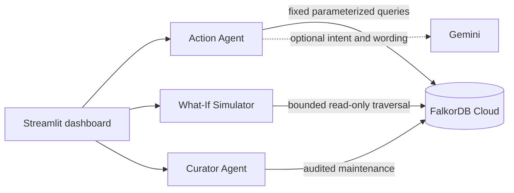
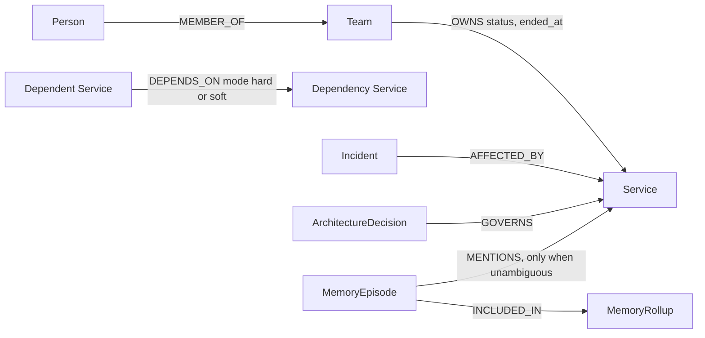

# HashiraGraph

**Self-Healing Multi-Agent Memory & Company Brain on FalkorDB** is a WeMakeDevs Graph Hacks demo for company knowledge, persistent agent memory, and explainable dependency-impact analysis. FalkorDB stores and traverses the graph. Gemini is optional and cannot generate or execute Cypher. All demo company data is synthetic.

Team **hashira** · Leader Soham Dhumal · Team code **N6F3C3**

## Problem and architecture

Company facts, service dependencies, owners, incidents, decisions, and agent exchanges need provenance and relationship context. HashiraGraph stores these as graph records. The Action Agent routes questions to a fixed set of parameterized graph tools and grounds answers in returned records. The Curator reports bounded maintenance actions and retains source records. The Streamlit UI exposes chat, evidence, health, recent memory, curator reports, and the read-only failure simulator.



## Graph data model



Dependency direction is **dependent service → dependency**. `hard` means a dependency failure propagates `DOWN` through that edge. `soft` means the edge can cause `DEGRADED` but cannot alone establish `DOWN`. A missing or unknown mode is treated conservatively as soft. The four-hop simulator bound limits query work and is not a statement about graph completeness.

`MemoryEpisode` records contain `id`, `tenant_id`, `session_id`, `created_at`, `kind`, `source`, `user_message`, `summary`, and evidence metadata. Kinds are `user_note`, `exchange`, `simulation`, and `recall`. Recall answers are logged for audit but excluded from default recall so memories never quote earlier memory answers; questions such as "What did I tell you..." search `user_note` only and "What did we simulate earlier?" searches `simulation` only. Conversation persistence has one owner: `ActionAgent`; the Streamlit callback only renders the result. Each new event gets a UUID. Retrying with a supplied ID uses `MERGE` with `ON CREATE SET`, preserving the original source, timestamp, and kind. Exact service names are linked to existing canonical service nodes only when one seeded name is unambiguous; memory retrieval still works for unlinked notes.

Graph names are selected from a fixed demo allowlist (`hashira_demo`, `demo_acme`). Graph separation and the episode tenant property are demo safeguards, not production authentication or a formal cross-tenant security boundary.

## Counterfactual failure simulator

The dashboard reads actual `Service` nodes for the target selector, validates selected names in the selected graph, and queries actual dependency paths. It does not change stored relationships or write a simulated failure. For each upstream service:

1. It is `DOWN` if any discovered path to a failed target consists entirely of `hard` edges.
2. It is `DEGRADED` if it is reachable but no all-hard path exists.
3. `DOWN` takes precedence if both types of path exist. Failed targets themselves are excluded from the affected list.
4. Paths are limited to four hops. Ranking is `DOWN`, then descending seeded criticality (`critical`, `high`, `medium`, `low`), then fewer hops, then service name alphabetically.

This is an explicit demo model, not a prediction of how every real incident propagates. Unknown edge modes are conservative (degraded only). Owning teams come from active `OWNS` relationships. The simulator compares graph node and relationship counts before and after; a mismatch is reported because concurrent graph activity can occur.

The simulator’s exact parameterized traversal is:

```cypher
MATCH p = (a:Service)-[:DEPENDS_ON*1..4]->(f:Service)
WHERE f.name IN $failed AND NOT a.name IN $failed
RETURN a.name AS service, f.name AS failed_service, length(p) AS hops,
       a.criticality AS criticality,
       [n IN nodes(p) | n.name] AS path,
       [r IN relationships(p) | coalesce(r.mode, 'unknown')] AS modes
```

The active owner lookup is:

```cypher
MATCH (t:Team)-[r:OWNS]->(s:Service)
WHERE s.name IN $services AND (r.status IS NULL OR r.status='active')
RETURN s.name, t.name ORDER BY s.name, t.name
```

The existing blast-radius tool also traverses the real dependency graph and returns relationship provenance:

```cypher
MATCH path = (affected:Service)-[:DEPENDS_ON*1..4]->(failed:Service {name:$failed_service})
OPTIONAL MATCH (team:Team)-[ownership:OWNS]->(affected)
WHERE ownership.status IS NULL OR ownership.status = 'active'
RETURN DISTINCT affected.name AS affected_service, team.name AS owner_team,
       [n IN nodes(path) | n.name] AS path_nodes,
       [r IN relationships(path) | type(r)] AS path_edges
ORDER BY affected_service
```

Tenant/session-scoped memory recall uses:

```cypher
MATCH (m:MemoryEpisode)
WHERE m.tenant_id=$tenant AND ($session='' OR m.session_id=$session)
  AND (($kind='' AND coalesce(m.kind,'exchange')<>'recall') OR coalesce(m.kind,'exchange')=$kind)
OPTIONAL MATCH (m)-[:MENTIONS]->(s:Service)
WITH m, collect(DISTINCT s.name) AS services
WHERE $service='' OR $service IN services
   OR toLower(coalesce(m.user_message,'')) CONTAINS toLower($service)
   OR toLower(coalesce(m.summary,'')) CONTAINS toLower($service)
RETURN m.id,m.session_id,m.created_at,m.kind,m.summary,m.user_message,m.source,services
ORDER BY m.created_at DESC LIMIT 20
```

Episode persistence uses a unique event ID and sets metadata only on first creation:

```cypher
MERGE (m:MemoryEpisode {id:$id})
ON CREATE SET m.tenant_id=$tenant, m.session_id=$session, m.created_at=$created,
              m.kind=$kind, m.user_message=$message, m.summary=$summary, m.source=$source,
              m.evidence_count=$evidence_count, m.evidence_json=$evidence_json
WITH m OPTIONAL MATCH (s:Service {name:$service})
WITH m, collect(s) AS services
FOREACH (canonical IN CASE WHEN size(services)=1 THEN services ELSE [] END |
         MERGE (m)-[:MENTIONS]->(canonical))
RETURN m.id
```

Service names and target names are passed as parameters. Queries use the shared `graph.ro_query` wrapper. The query strings and record counts are available in the expandable dashboard trace.

### Cloud scenario verification

The live seed and simulator were executed against `tenant_hashira_demo`. At verification time the graph had 29 nodes and 20 relationships. The three live scenarios returned:

| Failed target | Observed impacted services |
|---|---|
| Payment API | Checkout API `DOWN` (Checkout Team), 1 hop; Web Checkout `DOWN` (Web Team), 2 hops |
| Ledger Service | Payment API `DOWN` (Payments Team), 1 hop; Checkout API `DOWN` (Checkout Team), 2 hops; Web Checkout `DOWN` (Web Team), 3 hops |
| Fraud Service | Checkout API `DEGRADED` (Checkout Team), 1 soft hop; Web Checkout `DEGRADED` (Web Team), 2 hops (`hard → soft`) |

The live graph counts were unchanged before and after each of these read-only simulations. Counts are snapshots, not a lock against unrelated concurrent writes.

## Additional capabilities

**Chat-driven what-if.** "Simulate failure of Ledger Service" or "What if Fraud Service and Payment API go down?" routes deterministically (the model cannot choose targets) to the same read-only simulator as the dashboard and returns DOWN/DEGRADED services with owners and the exact path. Each run is stored as a `simulation` episode that can be recalled in a later session.

**Grounding check.** After every answer, `verification.verify_answer` checks that each named service, team, incident ID and decision ID in the answer appears in the retrieved evidence rows. If a model-written answer names something that was not retrieved, it is replaced by the deterministic evidence listing and the trace records why. This verifies named entities only; it is not a general semantic fact-checker.

**Fragility ranking.** "Which service is most dangerous to lose?" counts, per service, the dependents that would go DOWN (all-hard paths, at most 4 hops) and DEGRADED, using the same semantics as the simulator, and orders by those counts, then criticality. It also shows FalkorDB's `algo.betweenness` (fixed sampling seed 42 when supported) as an approximate chokepoint hint; the server samples paths, so this column does not affect ordering and is not a risk probability. If the procedure is unavailable the ranking still works and says so.

```cypher
MATCH p = (a:Service)-[:DEPENDS_ON*1..4]->(f:Service)
WHERE all(r IN relationships(p) WHERE r.mode = 'hard')
RETURN f.name, collect(DISTINCT a.name)
```

## Setup and configuration

Use Python 3.11 or newer. Docker is not required. Create a FalkorDB Cloud instance and enter the host, port, optional username/password, and TLS settings shown for that instance.

PowerShell:

```powershell
python -m venv .venv
.\.venv\Scripts\Activate.ps1
python -m pip install -r requirements.txt
Copy-Item .env.example .env
python check_config.py
```

Git Bash:

```bash
python -m venv .venv
source .venv/Scripts/activate
python -m pip install -r requirements.txt
cp .env.example .env
python check_config.py
```

Fill in `.env` locally. It is ignored by Git. `.env.example` contains only nonfunctional placeholders. `graph_store.py` resolves the project `.env` from its own source location, handles UTF-8 BOM, quoted values, whitespace-only external variables, and standard boolean values. Nonempty shell values take precedence. The checker prints only file/key presence and validation status; it never prints configured values and does not connect. Gemini is optional; leave `GEMINI_API_KEY` empty to use deterministic routing and evidence formatting.

Seed and verify the default `FALKORDB_GRAPH` (default `tenant_hashira_demo`):

```powershell
python seed_graph.py
```

Select a fixed allowlisted graph explicitly:

```powershell
python seed_graph.py --tenant hashira_demo
python seed_graph.py --tenant demo_acme
```

Seed data is synthetic. The seeder uses `MERGE`, sets an explicit mode on every seeded `DEPENDS_ON` edge, and preserves existing seeded entities. `--tenant` accepts only the two demo identifiers.

## Memory and agent behavior

Examples:

- “Remember this note: the hackathon demo focuses on explainable graph impact.” saves a `user_note` episode.
- “What did I tell you about the hackathon?” performs tenant-scoped cross-session recall.
- “What did I ask in this session?” filters to the current Streamlit session.
- “Recall my note about Payment API.” prefers service-linked or text-matching episodes.

Recall intent is selected deterministically before a model can suggest a tool. Tenant scope always comes from the authorized application context. A model-created session identifier cannot widen or suppress a query. Empty results and query errors are returned differently. The evidence trace contains the tool, safe query, count, and episode IDs; it does not include secret config values. Retrieval is attribute/text based, not embedding or semantic search.

## Curator scope

The curator inspects schema and high-degree nodes, considers only explicitly verified generic relationships with compatible labels, and reports a promotion only when a new canonical edge is confirmed. It preserves the source generic edge and existing facts. Ownership closes only when `ended_at` is explicitly present and a mutation returns a count. Memory rollups contain source episode IDs and `INCLUDED_IN` links; they are not generated semantic summaries. No action is reported as completed solely because a candidate was inspected.

## Tests and commands

```powershell
python -m unittest discover -s tests -t . -v      # or: python -m pytest -q tests
python -m compileall -q .
python check_config.py
streamlit run app.py
```

The suite has 88 tests that run by default (plus 5 opt-in live checks). Pure unit tests (configuration, intent parsing, citation validation, tenant authorization, error redaction) run anywhere. Integration tests run real Cypher on an embedded FalkorDB engine ([FalkorDBLite](https://pypi.org/project/falkordblite/), no Docker): seeding and idempotency, blast radius, every single and pair simulation checked against an independent Python path enumeration, hop bound, cycles, unknown modes, memory write/recall, tenant isolation, curator promotion/closure/rollups, fragility ranking, and a headless Streamlit run of the dashboard. Install `pip install -r requirements-dev.txt`; FalkorDBLite targets Linux/macOS, so on plain Windows these modules skip (use WSL to run them).

Opt-in live check against your Cloud instance. It writes only to a throwaway `tenant_ci_scratch_*` graph and deletes it:

```powershell
$env:HASHIRAGRAPH_LIVE_TEST = "1"
python -m unittest tests.test_cloud_live -v
Remove-Item Env:HASHIRAGRAPH_LIVE_TEST
```

The embedded engine and FalkorDB Cloud may run different server versions. The live check prints whether `algo.betweenness` is available on your instance.

## Three tracks and blog side prize

Intended hackathon fit (as listed on the [official Graph Hacks page](https://www.wemakedevs.org/hackathons/falkordb)):

- **Track 01 — Agents That Act on Connected Data:** bounded service traversal, ownership lookup, incidents, decisions, and cited graph provenance.
- **Track 02 — Agent Memory and Coordination:** Action Agent, Curator Agent, tenant-scoped persistent episodes, and bounded maintenance.
- **Track 03 — Company Brain:** connected teams, people, services, incidents, decisions, dependency modes, ownership history, and source records.
- **Side prize — Best Blog Post:** use the outline below; confirm exact submission naming and eligibility with the current event rules.

### Engineering blog outline

1. The failure-analysis and memory problems the graph models.
2. Architecture: FalkorDB Cloud, Python SDK, Action Agent, Curator, optional Gemini, Streamlit.
3. Relationship direction and hard/soft simulation semantics.
4. Tenant selection, memory episode lifecycle, and idempotent writes.
5. Parameterized queries, safe tool routing, and independent BFS test oracle.
6. What the three live demo scenarios showed, including their graph-count snapshots.
7. Limits and next work. Do not claim latency, recall, accuracy, or performance gains without repeatable measurements.

## Three-to-five-minute demo script

1. **0:00–0:30** — Open the dashboard and show that the selected tenant has live node and relationship counts.
2. **0:30–1:15** — Select `Payment API`, run the simulator, and show Checkout API and Web Checkout as `DOWN`, with owner and path evidence.
3. **1:15–2:00** — Change the target to `Fraud Service`; point out the soft edge and `DEGRADED` propagation through Checkout API to Web Checkout.
4. **2:00–2:40** — Ask a memory question, save a note, then recall it. Expand provenance and show the episode ID and retrieval query.
5. **2:40–3:30** — Ask about a service blast radius or ownership and show the actual graph path.
6. **3:30–4:15** — Run the Curator and explain confirmed mutation counts, retained originals, and source-ID rollups.
7. **4:15–4:45** — Close with limits: synthetic tenant allowlist, no semantic memory, no calibrated outage probability, and no performance claims.

## AI coding assistant disclosure

AI coding assistants were used to implement and review parts of the code and documentation. The project author is responsible for understanding and validating the final system.

## Known limitations

- The demo tenant allowlist is not caller authentication or production authorization.
- Memory search is tenant/session filtered and service-linked where possible, but does not use embeddings, vector search, or semantic ranking.
- The simulator is a deterministic four-hop model based on seeded `hard` and `soft` labels, not a calibrated operational risk model.
- The Streamlit UI requires a working FalkorDB connection; Gemini may be absent.
- No deployment, scale test, benchmark, production security review, or live second-tenant isolation test is claimed.
